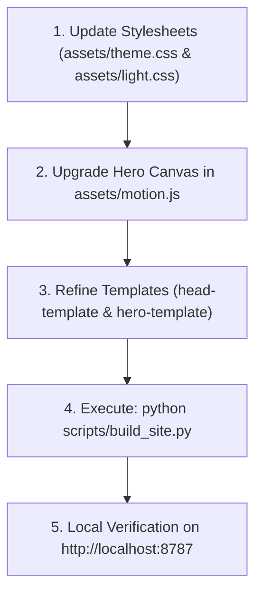

# ZAKAA Website UI/UX Modernization & Heritage Architecture Plan
**Document:** `UI_Enhancements.md`  
**Target:** `F:\Zaka2\ZAKAA_website`  
**Version:** 2.0 (Synchronized with Latest Multi-Page Architecture)  
**Theme Concept:** *Neo-Alexandrian Cyber-Heritage (The Confluence of Ancient Pharaonic Monumentalism, Islamic Golden Age Sciences, and Frontier Artificial Intelligence)*

---

## 1. Executive Re-Analysis: Architecture Ground Truth

Following the latest synchronization with `origin/main` (32 upstream commits), the website has evolved from a single monolithic file into a **modular, multi-page static ecosystem**:

```
                       ┌───────────────────────────────┐
                       │     scripts/build_site.py     │
                       └──────────────┬────────────────┘
                                      │
         ┌────────────────────────────┼────────────────────────────┐
         ▼                            ▼                            ▼
  📄 Templates & Partials       🎨 Assets (CSS & JS)         📦 Output Pages (19+)
  • head-template.html         • theme.css (Dark mode)      • index.html (Homepage)
  • hero-template.html         • light.css (Light mode)     • about.html (Company)
  • about-template.html        • base.css, catalog.css      • services.html, products.html
                               • motion.js (Canvas math)    • academy.html, projects.html
                               • site.js & theme-toggle.js  • Detail pages (erp360, etc.)
                               • 40+ Illustration SVGs      • sitemap.xml, project-data.js
```

### The Diagnostic Gap: Why the Current Design Needs Modernization
While the current site introduces an "observatory" aesthetic (dark carbon `#090b0e`, copper `#efad78`, ice `#9ed8d2`), it has drifted into a generic sci-fi space motif that misses the profound cultural identity of ZAKAA:
1. **Pharaonic Monumentalism is Missing:** The visual cards and containers use generic rounded borders (`16px`) without the architectural strength, pylon chamfers, and golden-ratio proportions ($\phi = 1.618$) of ancient Egypt.
2. **Arabic Scientific Ingenuity is Superficial:** The orbital rings in the hero are simple CSS squashed ovals (`scaleY(.58)`). They do not express the intricate, mathematical majesty of the **Astrolabe (الأسطرلاب)**, sacred Khatam star geometry, or Ibn Al-Haytham's optical refraction principles.
3. **Color Harmony in Light Mode is Muddy:** The light theme in `assets/light.css` defaults to a dull reddish brown (`#985225`) that lacks the regal glow of Egyptian **Solar Electrum Gold** and the luminous clarity of **Lapis Lazuli**.
4. **The Canvas Particle Loop is Abstract:** `assets/motion.js` renders a generic mathematical torus. It should be elevated into an **Astrolabe Neural Field** where celestial astrolabe coordinate rings intersect with neural attention vectors.

---

## 2. The Creative Triad: "Neo-Alexandrian Cyber-Heritage"

```
               ┌────────────────────────────────────────────────────────┐
               │              THE TRI-PILLAR DESIGN THESIS               │
               └────────────────────────────────────────────────────────┘
                                           │
         ┌─────────────────────────────────┼─────────────────────────────────┐
         │                                 │                                 │
         ▼                                 ▼                                 ▼
 🏛️ ANCIENT AUTHENTICITY        📐 SCIENTIFIC INGENUITY             ⚡ FRONTIER AI
 (Pharaonic Civilization)        (Arabic Golden Age of Science)      (Modern Intelligence)
 • Golden Ratio (1.618)           • Algorithmic Astrolabe matrix     • High-velocity telemetry
 • Hypostyle pylon structure      • Khatam star geometry (8-point)   • Neural vector embeddings
 • Sunlit Alabaster & Limestone   • Alhazen optical ray refractions  • Workers AI real-time chat
 • Solar Electrum Gold (#E5B25D)  • Al-Khwarizmi algebraic logic     • Low-latency interactive cards
```

---

## 3. Unified Design System & Dual-Theme Tokens

We will upgrade `assets/theme.css` (Dark / Basalt Obsidian) and `assets/light.css` (Light / Sunlit Alabaster):

### 3.1 Design Tokens Matrix

| Token | Dark Theme (Obsidian Void) | Light Theme (Sunlit Alabaster) | Heritage Meaning |
| :--- | :--- | :--- | :--- |
| `--z-bg-base` | `#110E0C` (Nile Basalt) | `#FAF7F2` (Sunlit Limestone) | Grounded monumentality |
| `--z-bg-surface` | `#191512` (Deep Charcoal) | `#F3EDE4` (Alabaster Papyrus) | Elevated reading plane |
| `--z-bg-card` | `#221C18` (Carved Pylon) | `#FFFFFF` (Pure Alabaster) | Tactile contrast |
| `--z-gold-solar` | `#E5B25D` (Solar Electrum) | `#C9933B` (Regal Gold) | Timeless excellence & brilliance |
| `--z-gold-radiant`| `#F7CB78` (Dawn Glow) | `#E5B25D` (Golden Sunlight) | Active / hover focus |
| `--z-lapis-cyan` | `#0EA5E9` (Optics Laser) | `#0284C7` (Lapis Lazuli) | Alhazen refraction / AI data beam |
| `--z-ink-primary` | `#F5EFE6` (Luminous Alabaster)| `#201A16` (Nile Ink) | High-contrast readability |
| `--z-ink-muted` | `#A69C92` (Weathered Sand) | `#6B6055` (Muted Sandstone) | Secondary descriptive copy |
| `--z-border-line` | `rgba(229,178,93,0.18)` | `rgba(52,37,28,0.14)` | Hairline precision |

### 3.2 Typographic Hierarchy
* **Latin Headings & Display:** `Space Grotesk` / `Plus Jakarta Sans` — architectural geometry with tight negative tracking (`-0.05em`).
* **Arabic Headings & Body:** `Tajawal` — crisp, commanding Arabic proportions with generous vertical baseline rhythm.
* **Telemetry & Coordinates:** `JetBrains Mono` — for astronomical coordinates, system statuses, and product IDs.

---

## 4. Multi-Page Blueprint & Template Transformations

### 4.1 Global `<head>` (`scripts/head-template.html`)
* Update theme colors and font preconnects:
  * Integrate `Space Grotesk` (400, 500, 600, 700), `Tajawal` (400, 500, 700), and `JetBrains Mono` (400, 500).
* Ensure smooth theme initialization script avoids any FOUC (Flash of Unstyled Content).

### 4.2 The Homepage Hero (`scripts/hero-template.html` & `assets/motion.js`)
* **Astrolabe Neural Matrix Canvas:**
  * Upgrade `assets/motion.js` so the `<canvas class="ai-network">` draws:
    1. Concentric graduated astrolabe coordinate circles with degree tick marks.
    2. Sacred 8-point Khatam star vertices pulsating subtly with optical refractions.
    3. Orbiting neural vector nodes (`01/NLP`, `02/VISION`, `03/PREDICT`, `04/AUTOMATE`) connected by delicate data beams.
  * In the center, the official `assets/brand-original.webp` logo sits inside a solar gold cartouche that tilts with smooth 3D mouse parallax.
* **Telemetry Ticker:** Update the top telemetry to reflect the Cairo crossroads:  
  `LOCATION: CAIRO [30.0444° N, 31.2357° E] // SYSTEM: WORKERS AI // COORD: ASTROLABE V2`.

### 4.3 Company Profile & About Page (`scripts/about-template.html` & `/about`)
* **Monumental Hypostyle Architecture:**
  * Structure the **Vision** and **Mission** cards into tall, monolithic architectural pylon frames with golden top markers.
  * Layer the SVG `arabesque.svg` and `feather.svg` ornaments as subtle ambient watermarks at 4-6% opacity that react to light/dark themes.
* **The 5 Core Disciplines & 3 Principles:**
  * Numbered with golden monospace identifiers (`٠١` / `01`, `٠٢` / `02`).
  * Micro-hover glow with solar gold gradient borders.

### 4.4 Catalogs & Bento Chambers (`assets/catalog.css`)
* Transform the product and services grids across `/services`, `/products`, `/initiatives`, and `/projects`:
  * Bento-box chamber styling with chamfered micro-corners (`var(--radius-sm)`).
  * Distinct category tag pills with lapis cyan accents.
  * Smooth card lift on hover (`transform: translateY(-4px)`) with warm gold ambient shadows.

### 4.5 Product Detail Pages (`assets/details.css`)
* The 12 detail pages (e.g. `erp360.html`, `madinaty-ai.html`, `masar.html`):
  * Elevate the concept illustration frame with an astrolabe watermark border.
  * Feature list styled with golden star checkmarks (`✳`).
  * Direct WhatsApp booking button styled with radiant gold gradient.

### 4.6 Interactive AI Assistant (`assets/chat.css` & `assets/chat.js`)
* Update the floating `Ask Zaka2` trigger into a sleek **Astrolabe Intelligence Capsule**:
  * Glowing lapis cyan indicator dot.
  * Interactive modal drawer featuring quick-prompt chips (e.g. *"What custom AI do you build?"*, *"How does ERP360 work?"*, *"كيف يساعد ذكاء الشركات النامية؟"*).
  * Direct integration with `/api/chat` (Cloudflare Workers AI) + built-in fallback simulation for offline/preview environments.

---

## 5. Implementation & Build Workflow

Because the site uses `scripts/build_site.py`, our implementation workflow is clean, declarative, and easily verified:



1. **Step 1:** Apply the Neo-Alexandrian design tokens and styles in `assets/theme.css` and `assets/light.css`.
2. **Step 2:** Enhance `assets/motion.js` with the Astrolabe Neural Canvas particle engine.
3. **Step 3:** Update the templates in `scripts/` to ensure all 19 pages receive the enhanced headers, cards, and metadata.
4. **Step 4:** Run `python scripts/build_site.py` to compile the entire static site into clean HTML.
5. **Step 5:** Preview and test across dark/light mode and English/Arabic on the local server at `http://localhost:8787`.

---

## 6. Execution Ready

This redesigned plan honors every single commit of the latest remote version while infusing it with the timeless gravitas of Egyptian civilization, the mathematical brilliance of Islamic sciences, and the cutting-edge power of artificial intelligence.

*Ready to implement upon your instruction.*
